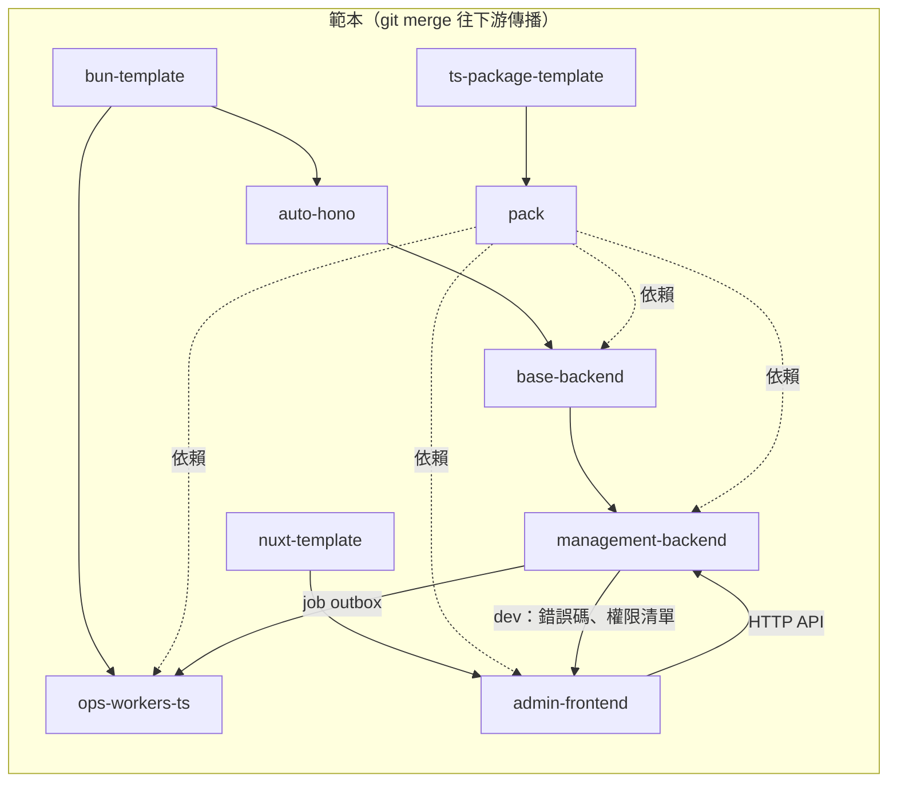

# main 架構

KCS 的主 repo：整合各服務 repo、部署設定與共用腳本。各服務是獨立的 git repo，clone 到 `repos/`。

## Repo 一覽

| Repo | 位置 | 說明 | 工具鏈 |
| --- | --- | --- | --- |
| main | 本 repo | 部署（compose、gateway）、跨 repo 腳本 | pnpm |
| [pack](https://github.com/kiki-core-stack/pack) | 獨立 | 共用程式碼：model、常數與型別、錯誤碼、多語系、權限、zod 擴充、provider、Hono 共用元件 | pnpm |
| [base-backend](https://github.com/kiki-core-stack/base-backend) | 獨立 | 後端範本：auto-hono 加上 pack 的錯誤處理、多語系、cookie session | bun |
| management-backend | `repos/` | 總管理後台 API（`/api/admin/*`）：管理員、身分組與權限、email／sms、平台設定 | bun |
| admin-frontend | `repos/` | 總管理後台前端（Nuxt、Element Plus） | pnpm |
| ops-workers-ts | `repos/` | 背景工作：處理 job outbox（寄送 email、sms） | bun |
| infra-services | 獨立 | 選用：MongoDB（replica set）、Dragonfly（Redis）等基礎服務的 compose | - |

## 關係

- **範本傳播**：每個 repo 以 `fetch-and-merge.sh` 合併其上游範本；共用的改動在最上游修改，再逐層合併下去。下游專案（各自的 fork）也以同樣方式合併 KCS。
- **pack**：各 repo 以 git commit 依賴（`@kcs-project/pack`）。
- **codegen**：admin-frontend 在 dev 啟動時打 management-backend 的開發用路由，產生錯誤碼與權限檔（見 [pack README](https://github.com/kiki-core-stack/pack)）。
- **job**：後端在同一個 transaction 寫入資料與 job outbox event，ops-workers-ts 取出後執行。

## 跨 repo 約定

- API 回應格式、錯誤碼、多語系、權限、enum 數值的規則見 [pack README](https://github.com/kiki-core-stack/pack)。
- 上游（KCS）commit 用英文約定式提交。

## 開發

1. 準備 MongoDB（需 replica set，transaction 用）與 Redis 相容服務（需支援 RESP3，例如 Redis 6+、Dragonfly）；可用 infra-services 啟動，也可自行準備，連線設定在各 repo 的 env。
2. 把服務 repo clone 到 `repos/`，執行 `install-all-dependencies.sh`。
3. 依各 repo 的 docs 設定 `.env.development.local`（範例為 `.env.development`）。
4. `tmux-run-all-dev.sh` 啟動 dev gateway，再依序啟動 ops-workers-ts、management-backend、admin-frontend（前端需等後端起來才能產生檔案）。

dev gateway（`stacks/gateway/dev`）跟正式 gateway 用同一套 nginx 設定，把 `/api` 轉給 host 上的 management-backend dev server、`/files` 對應本機檔案儲存、其餘轉給 Nuxt dev server（含 HMR）；host 的 proxy 只需把網域轉到 `127.0.0.1:${GATEWAY_EXPOSE_PORT}`。

- 以 `dev-gateway.sh` 操作（參數交給 `docker compose`，例如 `up -d`、`down`、`logs -f`），以 `network_mode: host` 執行。
- 設定只讀 `.env.development.local`（範例 `.env.development`）：各 dev server 的 port 須與各 repo 自己 env 的 port 相同；同一台機器跑多套時，`PROJECT_NAME` 與 `GATEWAY_EXPOSE_PORT` 各自不同。
- 經由網域存取時，admin-frontend 的 `DEV_VITE_SERVER_ALLOWED_HOSTS` 要包含該網域。

pack 推上遠端後，執行 `node update-pack-sha.mjs` 把 `repos/*` 的 pack 依賴改為 `.env.development.local` 的 `PACK_GIT_REF`（預設 `HEAD`，可為分支、tag 或完整 commit SHA）對應的 commit，再執行 `install-all-dependencies.sh`。

其他腳本：

- `scripts/pull-all-repos.sh`：pull 所有 repo。
- `scripts/check-all-repos.sh`：對所有 repo 依其工具鏈執行 `lint:fix`（會改檔）與 typecheck。
- `upgrade-all-dependencies.sh`、`cleanup-and-upgrade-all-dependencies.sh`：升級依賴。
- Shell 腳本規範見 `scripts/RULES.md`。

## 部署

- `docker-compose.yaml` 引入 `stacks/` 下各服務的 compose；gateway（`stacks/gateway/prod`，nginx）把 `/api` 轉給 management-backend、`/files` 對應本機檔案儲存（`FILE_STORAGE_LOCAL_BASE_PATH`，`private/` 不對外），其餘給 admin-frontend 的靜態檔；`/api/internal/*` 只供服務之間呼叫，gateway 一律回 404。
- 設定：`.env`（範例 `.env.example`）與 `.env.services`（範例 `.env.services.example`）；MongoDB、Redis 連線（`MONGODB_URI`、`REDIS_URL`）以 compose secret 傳入，可指向 infra-services 或自行準備的服務。
- 掛載進服務的 host 目錄由 `volume-permissions` 在服務啟動前建立，並把擁有者設為服務 image 的使用者（`10001:nogroup`）：`FILE_STORAGE_LOCAL_BASE_PATH` 掛在 `/files`（各服務共用）；`LOGS_ROOT_PATH/<服務>` 掛在 `/logs`（每個服務各自一個，新增服務時一併加進 `volume-permissions`）；由服務使用者寫入的 named volume 也掛進 `volume-permissions` 的 `/volumes/<volume>`。
- `docker-build-and-run.sh` 建置並啟動。
