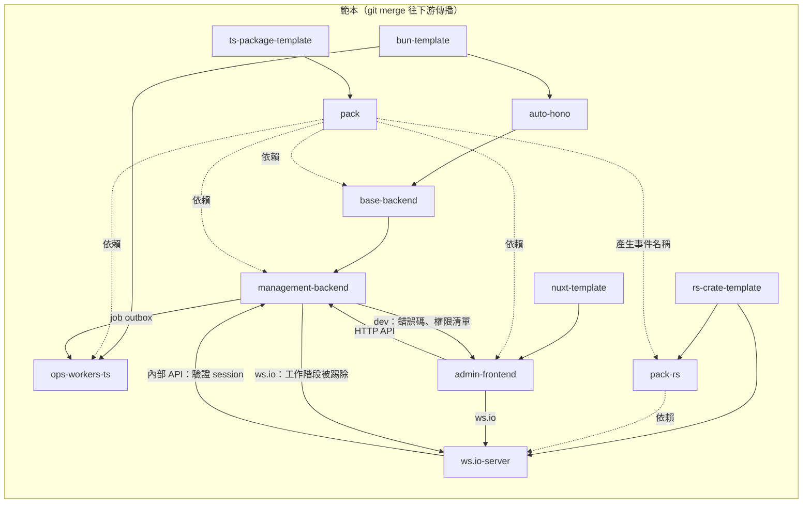

# main 架構

KCS 的主 repo：整合各服務 repo、部署設定與共用腳本。各服務是獨立的 git repo，clone 到 `repos/`。

## Repo 一覽

| Repo | 位置 | 說明 | 工具鏈 |
| --- | --- | --- | --- |
| main | 本 repo | 部署（compose、gateway）、跨 repo 腳本 | pnpm |
| [pack](https://github.com/kiki-core-stack/pack) | 獨立 | 共用程式碼：model、常數與型別、錯誤碼、多語系、權限、zod 擴充、provider、Hono 共用元件 | pnpm |
| [pack-rs](https://github.com/kiki-core-stack/pack-rs) | 獨立 | pack 的 Rust 對應，供下游 Rust 服務使用：API client（envelope、`ApiResponseError`）、WS.IO 事件名稱（由 pack 產生）、Redis key、共用 enum | cargo |
| [base-backend](https://github.com/kiki-core-stack/base-backend) | 獨立 | 後端範本：auto-hono 加上 pack 的錯誤處理、多語系、cookie session | bun |
| management-backend | `repos/` | 總管理後台 API（`/api/admin/*`）：管理員、身分組與權限、email／sms、平台設定 | bun |
| admin-frontend | `repos/` | 總管理後台前端（Nuxt、Element Plus） | pnpm |
| ops-workers-ts | `repos/` | 背景工作：處理 job outbox（寄送 email、sms） | bun |
| ws.io-server | `repos/` | 即時通訊（`/ws.io`，Rust）：驗證 admin-frontend 連線的 session，工作階段被踢除時即時通知前端登出 | cargo |
| infra-services | 獨立 | 選用：MongoDB（replica set）、Dragonfly（Redis）等基礎服務的 compose | - |

## 關係

- **範本傳播**：每個 repo 以 `fetch-and-merge.sh` 合併其上游範本；共用的改動在最上游修改，再逐層合併下去。下游專案（各自的 fork）也以同樣方式合併 KCS。
- **pack**：各 repo 以 git commit 依賴（`@kcs-project/pack`）。
- **codegen**：admin-frontend 在 dev 啟動時打 management-backend 的開發用路由，產生錯誤碼與權限檔（見 [pack docs](https://github.com/kiki-core-stack/pack/blob/main/docs/pack.md)）。
- **job**：後端在同一個 transaction 寫入資料與 job outbox event，ops-workers-ts 取出後執行。
- **ws.io**：admin-frontend 登入後連到 ws.io-server，ws.io-server 以 management-backend 的內部 API（`/api/internal/ws-io/*`，以 introspection token 驗證）驗證連線的 session，連線期間也會定期重新驗證。工作階段被踢除時，management-backend 送出事件給 ws.io-server（以 auth key 驗證），由它通知綁在這些工作階段上的連線強制登出。事件名稱定義在 pack，由 pack 產生 pack-rs 的 Rust 常數。

## 跨 repo 約定

- API 回應格式、錯誤碼、多語系、權限、enum 數值的規則見 [pack docs](https://github.com/kiki-core-stack/pack/blob/main/docs/pack.md)。
- 上游（KCS）commit 用英文約定式提交。

## 開發

1. 準備 MongoDB（需 replica set，transaction 用）與 Redis 相容服務（需支援 RESP3，例如 Redis 6+、Dragonfly）；可用 infra-services 啟動，也可自行準備，連線設定在各 repo 的 env。
2. 把服務 repo clone 到 `repos/`，執行 `install-all-dependencies.sh`。
3. 依各 repo 的 docs 設定 `.env.development.local`（範例為 `.env.development`）。
4. `tmux-run-all-dev.sh` 啟動 dev gateway，再依序啟動 ws.io-server、ops-workers-ts、management-backend、admin-frontend（management-backend 啟動時連線 ws.io-server 並執行系統初始化；前端需等後端起來才能產生檔案）。

dev gateway（`stacks/gateway/dev`）跟正式 gateway 用同一套 nginx 設定（路由見「部署」），只是上游換成 host 上的各 dev server（含 Nuxt HMR）。

- 以 `dev-gateway.sh` 操作（參數交給 `docker compose`），以 `network_mode: host` 執行。
- 設定只讀 `.env.development.local`（範例 `.env.development`）：各 dev server 的 port 須與各 repo 自己 env 的 port 相同；同一台機器跑多套時，`PROJECT_NAME` 與 `GATEWAY_EXPOSE_PORT` 各自不同。
- 預設只監聽 `127.0.0.1`；要讓區網其他機器直接連線時，把 `GATEWAY_EXPOSE_HOST` 設為 `0.0.0.0`。
- 經由網域存取時，admin-frontend 的 `DEV_VITE_SERVER_ALLOWED_HOSTS` 要包含該網域。

pack 推上遠端後，執行 `node update-pack-sha.mjs` 把 `repos/*` 的 pack 依賴（`package.json` 與 `Cargo.toml`）改為 `PACK_GIT_REF` 對應的 commit，再執行 `install-all-dependencies.sh`。`PACK_GIT_REF` 只從 `.env.development.local` 讀取，不會改讀 `.env.development`。

`scripts/check-all-repos.sh` 會對所有 repo 執行自動修正（會改檔）與型別檢查；Shell 腳本規範見 `scripts/RULES.md`。

## 部署

- `docker-compose.yaml` 引入 `stacks/` 下各服務的 compose；gateway（`stacks/gateway/prod`，nginx）把 `/api` 轉給 management-backend、`/ws.io` 轉給 ws.io-server、`/files` 對應本機檔案儲存（`FILE_STORAGE_LOCAL_BASE_PATH`，`private/` 不對外），其餘給 admin-frontend 的靜態檔；`/api/internal/*` 只供服務之間呼叫，gateway 一律回 404。gateway 只綁 host 的 `127.0.0.1:${GATEWAY_EXPOSE_PORT}`、只回應 `ADMIN_FRONTEND_SERVER_NAME`，對外由 host 的反向代理轉入。
- 設定：`.env`（範例 `.env.example`）與 `.env.services`（範例 `.env.services.example`，給所有服務）。全專案共用的秘密寫在 `.env`、以 compose secret 傳入，各服務不在自己的 env 重複設定：`MONGODB_URI`、`REDIS_URL`、`AUTH_SECRET_ENCRYPTION_KEYS`，以及 management-backend 與 ws.io-server 之間的 `MANAGEMENT_BACKEND_WS_IO_AUTH_KEY`、`MANAGEMENT_BACKEND_WS_IO_INTROSPECTION_TOKEN`（至少 32 bytes）。需要驗證管理員的服務所用的 `ADMIN_AUTH_ORIGIN` 由 compose 以 `ADMIN_FRONTEND_SERVER_NAME` 組出（`https://<網域>`），不另外設定。`COOKIE_SESSION_KEYS` 不共用，各服務在自己的 env 設定。
- 掛載進服務的 host 目錄由 `volume-permissions` 在服務啟動前建立，並把擁有者設為服務 image 的使用者（`10001:nogroup`）：`FILE_STORAGE_LOCAL_BASE_PATH` 掛在 `/files`（各服務共用）；`LOGS_ROOT_PATH/<服務>` 掛在 `/logs`（每個服務各自一個，新增服務時一併加進 `volume-permissions`）；由服務使用者寫入的 named volume 也掛進 `volume-permissions` 的 `/volumes/<volume>`。
- 系統初始化（預設管理員、平台設定等，pack `initializeSystem`）只由 management-backend 在啟動 workers 前執行一次，其他服務不執行。management-backend 的 healthcheck 在初始化完成、開始回應後才通過；其他連線資料庫的服務一律在 compose 加上 `depends_on: management-backend: condition: service_healthy`，不逐一判斷是否依賴初始化結果。
- `docker-build-and-run.sh` 建置並啟動；建置時以 SSH agent（`SSH_KEY_PATH`）取得私有 git 依賴。
